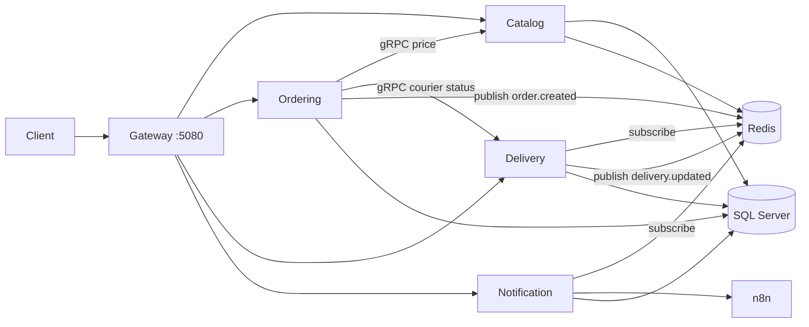

# Mini Food Delivery

A small ASP.NET Core system that takes a food order from the menu through to a courier and a notification. Each business area is its own service, its own SQL database, and its own container. The project is meant to be read and run while learning how those pieces talk to each other.

The customer-facing entry is the gateway at http://localhost:5080. API docs (Scalar) are on each service.

## What it is for

Use it to place an order against a real menu, watch that order create a delivery, and see a notification leave the system. The same path is the lesson:

| You want to learn | Where you see it |
| --- | --- |
| Split a product into services | Catalog, Ordering, Delivery, Notification |
| REST | Controllers under `/api/...` |
| CQRS | MediatR commands for writes, queries for reads |
| A synchronous call | Ordering calls Catalog and Delivery with gRPC and waits |
| An asynchronous call | Ordering publishes on Redis; Delivery and Notification react later |
| A cache | Catalog stores the restaurant list in Redis for 30 seconds |
| An API gateway | YARP on port 5080 forwards `/catalog`, `/orders`, `/delivery`, `/notifications` |
| One process per container | Docker Compose runs five containers |
| The same services on a cluster | `deploy/k8s` |
| A workflow outside the APIs | Notification posts each event to n8n |

## Advantages of this shape

- **Each service changes on its own.** A menu edit does not require a deploy of Delivery. Each service has its own database, so one team does not rewrite another team's tables.
- **The caller that needs an answer uses gRPC.** The price on the order comes from Catalog at the moment the order is saved. The client cannot send its own price.
- **The work that can wait uses Redis.** Delivery and Notification do not sit inside the order request. Ordering publishes `order.created` and returns. Those services keep running if you later add email, SMS, or another consumer on the same channel.
- **The cache makes the menu cheap to read.** Restaurant lists are read far more often than they change. Redis answers the repeat call. The `X-Cache` header shows `MISS`, then `HIT`.
- **The gateway is the only URL a client needs.** Services keep their own ports for Scalar and for debugging. The gateway is also the place to add a second instance later and round-robin traffic.
- **Docker and Kubernetes use the same images.** Compose is the laptop run. The manifests in `deploy/k8s` are the same containers with a Service in front of each one.
- **n8n keeps workflow edits out of C#.** Turning an order event into a message, a sheet row, or a chat post is a workflow import, not a new deploy of Notification.

## System context

People and other containers sit outside the five services. SQL Server, Redis, and n8n are already running in Docker. The food services reach them through `host.docker.internal`.



## Walk a single order

1. The client sends `POST /orders/api/orders` to the gateway. The gateway forwards it to Ordering.
2. Ordering calls Catalog `GetMenuItem` over gRPC and waits. The menu price is the price stored on the order. This is the synchronous call.
3. Ordering inserts the order in `MiniFoodOrdering` and returns `201`.
4. Ordering publishes `order.created` on the Redis channel `minifood.orders`. It does not wait for Delivery to finish. This is the asynchronous call.
5. Delivery, already subscribed, inserts a `WaitingForCourier` job in `MiniFoodCourier`.
6. Notification stores a row and POSTs the event to the n8n webhook.
7. `GET /orders/api/orders/{id}` calls Delivery `GetByOrderId` over gRPC and adds `deliveryStatus` to the response.

Assign a courier with `POST /delivery/api/deliveries/{id}/assign`. Delivery publishes `delivery.updated` on `minifood.deliveries`, and Notification stores a second row.

Redis pub/sub does not keep the message. Delivery and Notification have to be running when the event is published. A broker such as RabbitMQ would store it. This project leaves that out so the difference is easy to see in the logs: Ordering writes `Redis delivered it to N subscriber(s)`.

## Services

| Service | Container | Host port | Database | Owns |
| --- | --- | --- | --- | --- |
| Gateway | `minifood-gateway-1` | 5080 | none | Routes only |
| Catalog | `minifood-catalog-1` | 5081 | `MiniFoodCatalog` | Restaurants and menu items |
| Ordering | `minifood-ordering-1` | 5083 | `MiniFoodOrdering` | Orders and lines |
| Delivery | `minifood-delivery-1` | 5084 | `MiniFoodCourier` | Courier jobs |
| Notification | `minifood-notification-1` | 5085 | `MiniFoodNotification` | Notification rows and the n8n call |

Inside Catalog and Delivery, port 8080 is REST and port 8081 is gRPC. HTTP/2 without TLS cannot share the REST port, so gRPC has its own port. Ordering calls `http://catalog:8081` and `http://delivery:8081`.

Scalar:

- Catalog http://localhost:5081/scalar
- Ordering http://localhost:5083/scalar
- Delivery http://localhost:5084/scalar
- Notification http://localhost:5085/scalar

Gateway routes:

| Public path | Forwards to |
| --- | --- |
| `/catalog/...` | Catalog |
| `/orders/...` | Ordering |
| `/delivery/...` | Delivery |
| `/notifications/...` | Notification |

The response header `X-Service-Instance` is the container that answered. `X-Gateway` is the gateway.

## Code map

```text
src/Gateway/Gateway.Api                         YARP routes
src/Services/Catalog/Catalog.Api                REST, CQRS, Redis cache, gRPC server
src/Services/Ordering/Ordering.Api              REST, CQRS, gRPC client, Redis publisher
src/Services/Delivery/Delivery.Api              Redis subscriber, gRPC server, REST
src/Services/Notification/Notification.Api      Redis subscriber, n8n webhook, REST
src/BuildingBlocks/MiniFood.BuildingBlocks      protos, events, Redis bus, SQL connection
deploy/Dockerfile                               one image build, project chosen by ARG
docker-compose.yml                              one container per service
deploy/k8s                                      namespace, config, secret, deployments
n8n/order-created-workflow.json                 webhook workflow to import
requests/minifood.http                          sample calls
```

CQRS lives in each service's `Features` folder. A command writes (`CreateOrder`). A query reads (`GetOrder`, `GetRestaurants`). The controller only sends the request through MediatR.

Contracts:

- `Protos/catalog.proto` — `GetMenuItem`
- `Protos/delivery.proto` — `GetByOrderId`
- `Events.cs` — `order.created` and `delivery.updated`

## Seed menu

| Restaurant | Id |
| --- | --- |
| Golden Bowl, Burmese, Pansodan Street | `11111111-1111-1111-1111-111111111111` |
| Mohinga, 3500 MMK | `11111111-1111-1111-1111-111111111102` |
| Tea Leaf Salad, 4500 MMK | `11111111-1111-1111-1111-111111111101` |
| River Tea House, Shan | `22222222-2222-2222-2222-222222222222` |
| Shan Noodles, 4000 MMK | `22222222-2222-2222-2222-222222222201` |
| Milk Tea, 1500 MMK | `22222222-2222-2222-2222-222222222202` |

Two Mohinga and one tea leaf salad total 11500 MMK.

## Run with Docker

SQL Server, Redis, and n8n are expected to be running already. Copy the password file once:

```bash
cp .env.example .env
```

Set `SQL_SA_PASSWORD` in `.env` to the `sa` password of the `sqlserver2022` container. Compose reads that file. Containers use `host.docker.internal` to reach SQL on port 1433, Redis on 6379, and n8n on 5678.

```bash
docker compose up --build -d
```

That starts five containers, one service each. Tables are created on startup.

```bash
curl http://localhost:5080/catalog/api/restaurants
```

Call it again and check `X-Cache`. The second response should be `HIT`.

Place an order:

```bash
curl -X POST http://localhost:5080/orders/api/orders \
  -H 'Content-Type: application/json' \
  -d '{
    "restaurantId": "11111111-1111-1111-1111-111111111111",
    "customerName": "Thet",
    "deliveryAddress": "12 Strand Road, Yangon",
    "lines": [
      { "menuItemId": "11111111-1111-1111-1111-111111111102", "quantity": 2 },
      { "menuItemId": "11111111-1111-1111-1111-111111111101", "quantity": 1 }
    ]
  }'
```

Then read the side effects:

```bash
curl http://localhost:5080/delivery/api/deliveries
curl http://localhost:5080/notifications/api/notifications
```

`scripts/demo.sh` runs this sequence. `scripts/run-local.sh` starts the five projects with `dotnet run` instead of containers. Local gRPC targets are `http://localhost:5081` and `http://localhost:5084` from `.env`.

## n8n

1. Open http://localhost:5678.
2. Import `n8n/order-created-workflow.json`.
3. Activate the workflow.

The URL Notification calls is `http://localhost:5678/webhook/minifood-order-created`. While the editor is listening, n8n uses `/webhook-test/` instead. Set `N8N_WEBHOOK_URL` to that test URL if you want to watch the run on the canvas.

The notification row is saved either way. `n8nDelivered` is `false` and `n8nError` explains the HTTP status when the workflow is off.

## Kubernetes

Manifests are in `deploy/k8s`. Each Deployment runs one container. Catalog and Delivery expose 8080 for REST and 8081 for gRPC. The gateway Service is `type: LoadBalancer` on port 5080.

Docker Desktop Kubernetes has to be switched on in Docker Desktop settings before `kubectl` has a context. Build the images first so the cluster can use the local tags (`imagePullPolicy: IfNotPresent`):

```bash
docker compose build
kubectl apply -k deploy/k8s
kubectl get pods,svc -n minifood
```

`SQL_SA_PASSWORD` is in `deploy/k8s/secret.yaml`. `SQL_HOST` and `REDIS_HOST` are `host.docker.internal`, which Docker Desktop provides inside the cluster.

## What this project leaves out

There is no login. Schema updates use `EnsureCreated`, which creates a missing database and does not alter tables that already exist. Prices are `decimal` in SQL and a string on the gRPC contract. The gateway in this Compose file points at one Catalog container. The YARP cluster is still marked `RoundRobin`, so a second Catalog destination can be added without changing clients.
